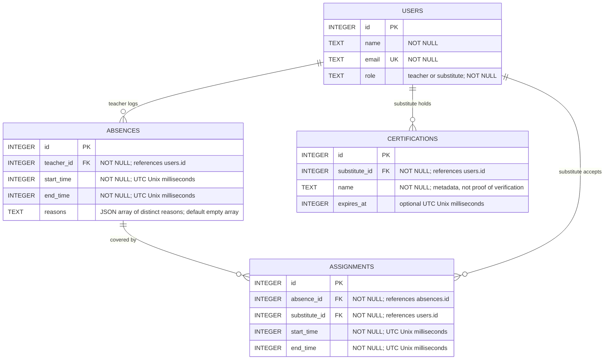
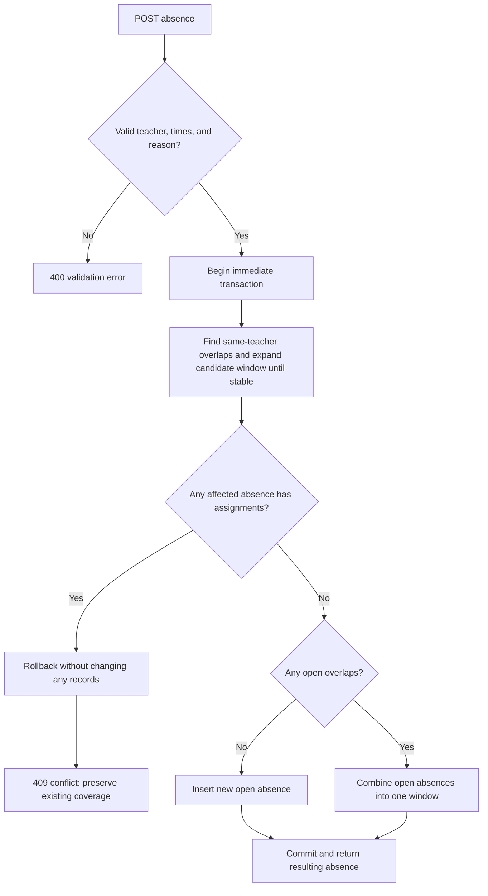
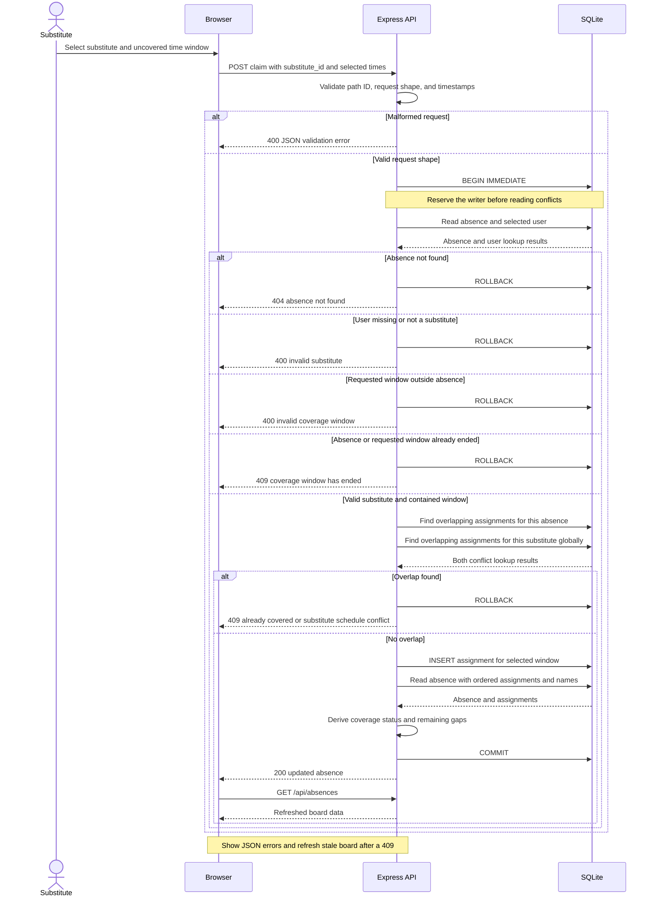

# System Architecture & Schema Design

> **Status: reviewed architecture; proceeding to database/API implementation.** This document is the implementation contract agreed through collaborative review. It includes explicitly requested extensions beyond the original whole-shift exercise.

Approved: split assignments, UTC millisecond storage, distinct merge reasons, lowest-ID merge survival, required claim times, expiry rejection, substitute cancellation, teacher early return, informational certification metadata, coherent read snapshots, and all-or-nothing transactions. No authentication, full audit trail, credential eligibility engine, or automatic break inference is included.

## 1. Database Schema (Mermaid ERD)



### Relationships and derived status

- Each absence belongs to exactly one teacher; a teacher can have zero or many absences.
- Each absence has zero or many assignments. Each assignment belongs to one absence and one substitute and has its own time window.
- `teacher_id` and `substitute_id` reference the existing `users` table. Their required roles are validated by the API; foreign keys alone do not enforce roles.
- Do **not** make `absence_id` or `substitute_id` unique in assignments: an absence can be split, and a substitute can cover many non-overlapping windows.
- **Open:** no assignments. **Partially Covered:** some assigned time, but at least one uncovered gap. **Claimed:** the entire absence window is covered without gaps.
- Derive status and uncovered windows from assignments ordered by start time; do not store status or a coverage counter. A single partial assignment is not a fully claimed absence.

For example, a 09:00–15:00 absence can have substitute A covering 09:00–12:00 and substitute B covering 12:00–15:00. Both assignments together make it Claimed. Cancelling the second window reopens that portion and leaves the absence Partially Covered. Cancellation is now an explicitly requested extension.

### Constraints and time policy

| Concern | Proposed enforcement |
| --- | --- |
| Valid user role values | Existing `users.role` check constraint |
| Referenced users exist | Foreign keys with SQLite foreign keys enabled |
| Required fields | `NOT NULL` on teacher/times in absences and absence/substitute/times in assignments |
| Positive duration | Database `CHECK (end_time > start_time)` on both time-window tables plus API validation |
| Correct teacher/substitute roles | API checks against `users.role` |
| Valid timestamps | API validates calendar values and requires an explicit timezone; stores normalized integer milliseconds |
| Assignment inside its absence | API requires `absence.start <= assignment.start < assignment.end <= absence.end`, checked inside the claim transaction |
| No double coverage of one absence | Reject any overlap with an existing assignment for that absence, even for a different substitute |
| No overlapping substitute assignments | Reject any overlap for that substitute across all absences |
| Atomic conflict checks | Both assignment-overlap checks and the insert run in the same immediate transaction |
| Overlapping absences for one teacher | Merge only windows with no assignments; reject if any affected absence has even partial coverage; checks/writes run in one immediate transaction |

The API returns canonical ISO timestamp strings. Separate browser date/time controls are interpreted in the browser's local timezone and converted to ISO before submission. The UI displays whole seconds, not milliseconds: dates start blank, 15-minute choices start at midnight, and double-click or an accessible edit button enables exact whole-second input. Claim fields fill known bounds only after explicitly choosing a gap; unchanged API-origin bounds retain their exact stored instant internally.

**Approved:** display the interpreted timezone clearly. Include the offset with displayed time ranges, especially around daylight-saving transitions. A configured school timezone is a possible later extension, not implicit in UTC storage.

**Approved contract:** ISO input/output with `Z` or a numeric UTC offset; integer UTC Unix milliseconds in SQLite. Milliseconds match JavaScript's `Date` representation, avoiding unit conversions with no material impact at this scale. Seconds and Julian-day storage were considered; milliseconds were selected for implementation convenience, not because school scheduling requires sub-second precision.

**Revised precision policy:** accept otherwise valid ISO timestamps with more than three fractional-second digits and truncate the fractional part to milliseconds before storage, comparison, and response serialization. For example, `2026-11-07T09:00:00.123456Z` becomes `2026-11-07T09:00:00.123Z`. Validate the complete input's syntax, calendar values, and timezone before discarding any digits; truncation must not rescue malformed input. No fractional part, one digit, or two digits can be represented exactly at millisecond precision.

The parser accepts calendar timestamps with seconds, four-digit or signed six-digit years, and an explicit colon-separated UTC offset or `Z`. Leap seconds, timezone-less/date-only inputs, and values outside JavaScript's representable date range are rejected. SQL timestamp checks enforce integer values within that same date range. Truncating fractional digits before offset conversion also works correctly for pre-epoch dates.

Truncation deliberately discards sub-millisecond information; preserving that information would require higher-precision storage or retaining the original input as well. Return canonical normalized timestamps so the chosen resolution is visible. Check positive duration, assignment containment, and overlaps **after normalization**. A valid positive sub-millisecond interval can collapse to equal endpoints: reject that unrepresentable zero-duration interval with `400`, rather than inventing a longer window. Never compare raw mixed-offset strings or accept ambiguous timezone-less API timestamps.

**Approved:** intervals are half-open (`[start, end)`), so a shift ending at 10:00 does not conflict with one starting at 10:00. Adjacent teacher absences remain separate. Overlap exists when:

```text
existing.start_time < requested.end_time
AND existing.end_time > requested.start_time
```

Indexes: `absences(teacher_id, start_time)`, `assignments(absence_id, start_time)`, and `assignments(substitute_id, start_time)`. Certifications have a unique `(substitute_id, name)` pair. These support the main lookup/conflict paths without asserting that a simple unique index can prevent interval overlaps. Credentials are informational, returned with users; no credentials will be fabricated for the starter users and credential management/verification is deferred.

Database triggers are an alternative if role, assignment containment, and overlap rules must also protect direct SQL writes. The proposed implementation uses API validation and immediate transactions for these cross-row rules, alongside database foreign keys and row checks; it does not claim protection against arbitrary direct SQL writes violating cross-row invariants.

The user agrees with layered enforcement boundaries. Parameterized SQL and safe rendering of free text are also required implementation practices. These measures protect data integrity and reduce injection risks, but do not provide authentication or ownership authorization: submitted user IDs are still simulated actors in this take-home.

### Approved teacher-overlap rule

- Only combine absences belonging to the **same teacher**.
- Overlapping open absences become one window, using the earliest start and latest end. Include every overlap connected to that combined window.
- If any affected absence has **any assignment**, including partial coverage, reject the entire request with `409 Conflict`. Do not change its dates, its assignments, or any open records.
- Perform overlap discovery and merge writes in one immediate transaction, so a substitute cannot claim a record between the merge check and update.
- Under the approved half-open interval policy, merely adjacent absences remain separate.
- Different teachers may be absent at the same time; their records are never merged. A substitute still cannot cover overlapping shifts across those teachers.

Example: an open 09:00–12:00 absence and a new 11:00–14:00 absence become 09:00–14:00. If the existing absence is claimed, reject instead: the substitute only agreed to 09:00–12:00.

**Approved:** preserve distinct reasons when merging; different descriptions do not prevent merging. Storage is a JSON array in `absences.reasons` so paragraph boundaries are not confused with reason separators. The API still accepts one optional `reason` string per submission and returns a `reasons` array. Trim outer whitespace, ignore empty reasons, and deduplicate exact strings without case folding. Limit each reason to 2,000 characters and combined serialized reasons to 32 KiB; reject excess rather than discard information.

**Approved merge identity:** preserve the lowest existing absence ID; delete only other merged, unassigned records inside the same transaction. If there are no overlapping records, insert a new absence with a new ID.

Basic history can be read from retained records; counts should be computed rather than stored, and after merging count combined absence windows rather than submissions. Reasons are preserved, but their original time windows and every original submission are not. A full audit trail is outside the agreed feature.

## 2. API & Conflict Flow (Mermaid Sequence / Flowchart)

### Endpoints

| Endpoint | Request | Success |
| --- | --- | --- |
| `GET /api/users?role=teacher` or `substitute` | Existing user lookup | `200`, user array |
| `POST /api/absences` | `{ teacher_id, start_time, end_time, reason? }` | `201` for a new absence, `200` for a merge; resulting absence in either case |
| `GET /api/absences` | No body | `200`, array with teacher name, reasons, assignment/substitute details, uncovered windows, and derived status |
| `POST /api/absences/:id/claim` | `{ substitute_id, start_time, end_time }`; both times required | `200`, updated absence including its assignments |
| `POST /api/assignments/:id/cancel` | `{ substitute_id }` | `200`, updated absence with reopened future coverage |
| `POST /api/absences/:id/return-early` | `{ teacher_id, end_time? }`; omitted end means server now | `200`, shortened absence with adjusted assignments |

Creation validates the teacher's existence/role, timestamps, and optional reason before insertion or merging. Invalid creation input returns `400`; an overlap involving a claimed absence for that teacher returns `409`. Listing returns all absences, including claimed ones, with deterministic ordering.

The user approved the proposed HTTP status distinctions: `201` created, `200` merged/claimed, `400` invalid input, `404` missing absence, and `409` scheduling/claim conflict.

**Approved claim intent rule:** every claim must provide both start and end timestamps, even for a whole absence. Missing times, an invalid window, or a window outside the absence returns `400`. Any overlap with already covered time, or another assignment for that substitute, returns `409`. Do not silently trim, split, move, or expand a requested window. The optional-time whole-current-absence shortcut is removed.

**Approved expiry rule:** do not claim an already-ended absence or requested coverage window. Return `409` when `end_time <= server_now`, with one server-clock value captured inside the transaction and an injectable clock for deterministic tests. An in-progress window may include an elapsed start as long as its end is future; no additional future-start restriction was requested. Historical absence creation remains allowed.

Use JSON errors shaped as `{ error: { code, message } }`. Wrong roles/invalid users return `400`; a supplied actor who does not own the target assignment/absence returns `403` (still simulated identity, not authentication). Bound JSON bodies to 32 KiB (`413` on overflow). Use a bounded SQLite busy timeout; return retryable `503` with `Retry-After` on lock contention, and sanitized `500` for unexpected failures. Do not convert every database failure into a business conflict.

The UI should show every assignment and remaining gap, allow claims on Open and Partially Covered absences, and send explicit selected time windows. This preserves the user's intended range even if the board becomes stale. A fully covered absence remains Claimed as required by the original spec; Partially Covered is the user-approved split-coverage extension's additional state.

Pending controls prevent duplicate clicks; after ambiguous network failures, refresh current assignments rather than blindly retrying writes. Refresh after successful writes and stale `404`/`409` responses. Explicit times prevent silent time expansion, but do not make a browser board permanently current. Use a short consistent read snapshot when assembling absences, assignments, statuses, and gaps; display a last-updated indicator and refresh controls. Polling or server push remains optional.

### Create or merge flow



Both creation/merging and claiming must use the same write-transaction discipline. If a merge wins first, a subsequent claim must read the resulting window; a stale ID removed by the merge returns `404`. If a claim wins first, the overlapping creation request returns `409` without changing coverage.

### Claim transaction



Use `better-sqlite3`'s immediate transaction wrapper rather than manually scattering transaction statements through routes. The diagram shows the conceptual boundaries. Unexpected failures must roll back; lock contention needs deliberate handling rather than exposing raw SQLite errors.

An immediate transaction serializes competing writers before conflict reads. With the new assignment table, claiming inserts a row rather than updating a nullable substitute column. There is no blanket one-assignment-per-absence constraint: the transaction protects interval exclusivity both within an absence and across a substitute's schedule. Adjacent non-overlapping claims can both succeed, including claims by different substitutes covering one absence.

### Cancellation and early return

These are explicit lifecycle operations, not exceptions that allow ordinary merging to change accepted coverage. The user approved the recommended cancellation, transaction, and recovery approach. Implementation boundaries:

- **Substitute cancellation:** validate the selected actor owns the assignment. For an entirely future assignment, delete it and reopen that window. For an in-progress assignment, retain its elapsed portion and release only the remainder, using a single server-clock cutoff. Do not reopen historical time as if it had never been covered. Reject cancellation of already-ended assignments with `409`.
- **Teacher early return:** validate the teacher owns the absence and shorten its end. Leave assignments ending before the cutoff alone, truncate those crossing the cutoff, and remove those starting at/after it. Update the absence and all assignments in the same transaction. Never extend a shift through this operation. Omitted end means server now; an explicit cutoff cannot backdate before now. Reject a cutoff at/before the absence start (`400`), an extension (`400`), or changing an already-ended absence (`409`). An explicit retry matching the current end is a no-op success after actor validation. Whole-absence cancellation before it starts is deferred.
- All lifecycle operations, merges, and claims use the same immediate write-transaction boundary. A failure rolls back every change, not just the last SQL statement. No asynchronous network work belongs inside the transaction.
- Full audit history remains deferred. The proposed retain/truncate/delete approach preserves elapsed coverage without adding a full event log, but does not record every cancellation reason or previous commitment.

### Efficiency and coherent reads

Gap computation is a cursor scan over assignments ordered by start time: `O(k)` for `k` assignments, with `O(g)` output for `g` gaps (at most `k + 1`). An `(absence_id, start_time)` index avoids a separate sort when the query planner uses that order. No minute-by-minute search or all-pairs comparison is needed.

For teacher merges, a simple indexed overlap query is the clearest baseline. A composite B-tree does not automatically make a two-ended interval query `O(log n + matches)`; many historical rows can still require filtering. Because the application maintains non-overlapping absences per teacher, an optional tighter algorithm uses one predecessor lookup and a start-time range scan, approximately `O(log t + m)` for `t` teacher records and `m` matches, plus writes. Its invariant and alternatives are explained in `DESIGN_REVIEW.md`.

Assemble a list response from batched absence/assignment reads in one short read transaction, not per-row queries across inconsistent snapshots. Keep write transactions short; SQLite still serializes writers. Test real separate connections/processes as well as ordinary API outcomes.

## 3. Design Review & Corrections

Actual refinements from the user's design review:

- **Correction 1 — combine duplicate teacher windows:** the initial proposal left teacher overlaps unresolved. The user requested merging overlapping open absences for the same teacher instead of keeping overlapping records or rejecting every overlap.
- **Correction 2 — preserve accepted coverage:** discussion of merging exposed the risk of silently extending a substitute's shift. The user approved rejecting an overlap involving any claimed absence, with no partial merge or assignment changes. This also requires merge checks/writes to be atomic with respect to claims.
- **Correction 3 — model real split coverage:** the initial nullable substitute column, and later suggestion to defer multiple assignments, could not represent different substitutes covering portions of one absence. The user requested split coverage now. Introduced timed assignments, both absence-level and substitute-level conflict checks, a derived Partially Covered state, and merge protection for any existing assignment. The user also chose ISO/millisecond timestamps and preservation of distinct merge reasons.

### Final scope and implementation defaults

The user requested proceeding after the final review. Use the documented model and lifecycle defaults above, with these boundaries:

1. Distinct trimmed reasons are a JSON array, not a submission audit trail.
2. Precision edge case to cover in tests: reject intervals that become zero-duration after truncation, while accepting valid finer-precision inputs with positive normalized duration.
3. Agreed enforcement boundaries: cross-row role/containment/overlap checks in the transactional API, SQL constraints for structural integrity. Database-wide trigger protection is not part of the current implementation plan.
4. Use the cancellation/early-return behavior, in-progress claim policy, and read-snapshot/network recovery described above.
5. Breaks use separate required-coverage absence windows (for example, 09:00–12:00 and 13:00–16:00), not guessed lunch breaks inside 09:00–16:00. Certifications are display-only metadata; eligibility and expiry enforcement, availability calendars, and workload limits are deferred.

Authentication and full audit history remain deferred; the user deprioritized reason-privacy features for this exercise. Keep basic input validation, parameterized SQL, and safe rendering. Split coverage, substitute cancellation, and teacher early return are explicitly requested extensions. Selecting an existing user still simulates the actor; ownership checks on supplied IDs are not authentication. Ended coverage cannot be claimed; historical absence creation has not been prohibited.

## 4. Risk Review and Unsupported Real-World Uses

See `DESIGN_REVIEW.md` for prospective failure scenarios, test recommendations, algorithm complexity, and production limits. The stale optional-time claim shortcut has been removed following user review. Other recommendations are not automatically approved beyond the goals recorded above.

## 5. Implementation Checkpoint

Database/API milestone implemented in `src/db.js`, `src/app.js`, `src/coverage.js`, `src/validation.js`, and `src/errors.js` (commit `2e19f21`). Frontend implemented in `public/index.html` and deferred vanilla `public/app.js`; no frontend framework or build step. JSDOM is a dev-only test dependency.

The UI provides teacher/substitute selectors, creation/merge feedback, all coverage statuses, assignments and multiple gaps, explicit selected-range claims, cancellation/early-return confirmations, informational credentials, local-time/UTC-offset previews, and last-update/refresh controls. It renders untrusted text with DOM text APIs and preserves actors/edited claim ranges across refreshes. One client operation is pending at a time. Network failures/invalid responses/timeouts never automatically retry a write; a failed reload disables mutations until refresh succeeds.

Chosen gap inputs retain their original ISO instant while unchanged, avoiding ambiguous-DST-fold loss and accidental millisecond truncation when showing whole seconds. Editing date/time intentionally creates a whole-second value; switching editor modes alone preserves the original instant. Exact times are not silently snapped to quarter-hour boundaries. Complete and incomplete drafts survive refresh, and optional early-return edits require a date rather than silently becoming "return now". User-edited local dates are checked for calendar/DST normalization; ambiguous times use the browser's earlier occurrence shown in the preview.

Verification: **118 automated tests pass** (72 API, 3 gap scan, 9 file-backed concurrency/persistence, 34 frontend DOM/API). Independent-process tests verify competing writers/coherent reads; trigger failures verify rollback. All three Mermaid diagrams pass syntax validation. Chromium verified revised pickers and real double-click editing, midnight defaults, no visible milliseconds, desktop/mobile, lifecycle flows, two-page conflicts, lost responses, and New York DST with no uncaught page errors. See `DEMO.md` for a walkthrough and tooling limits.
