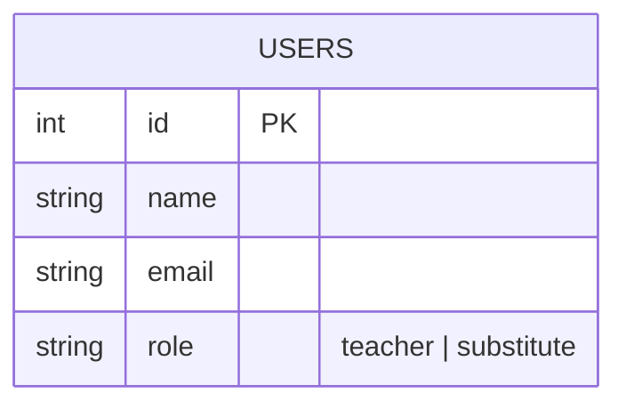
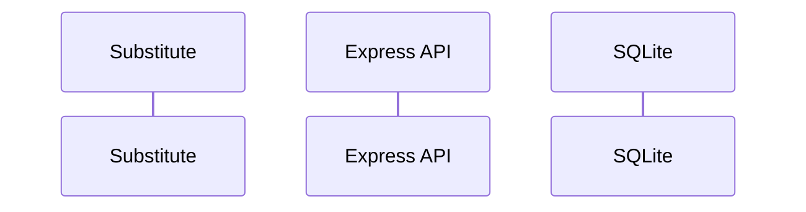

# System Architecture & Schema Design

## 1. Database Schema (Mermaid ERD)
<!-- Paste your AI-generated (and reviewed) Mermaid erDiagram below -->

## 2. API & Conflict Flow (Mermaid Sequence / Flowchart)
<!-- Paste your Mermaid sequenceDiagram or flowchart for claiming a shift below -->

## 3. Design Review & Corrections
*Briefly list 2-3 things your AI initially suggested that you refined, rejected, or prompted it to fix before/during implementation:*
- **Correction 1:** 
- **Correction 2:** 
