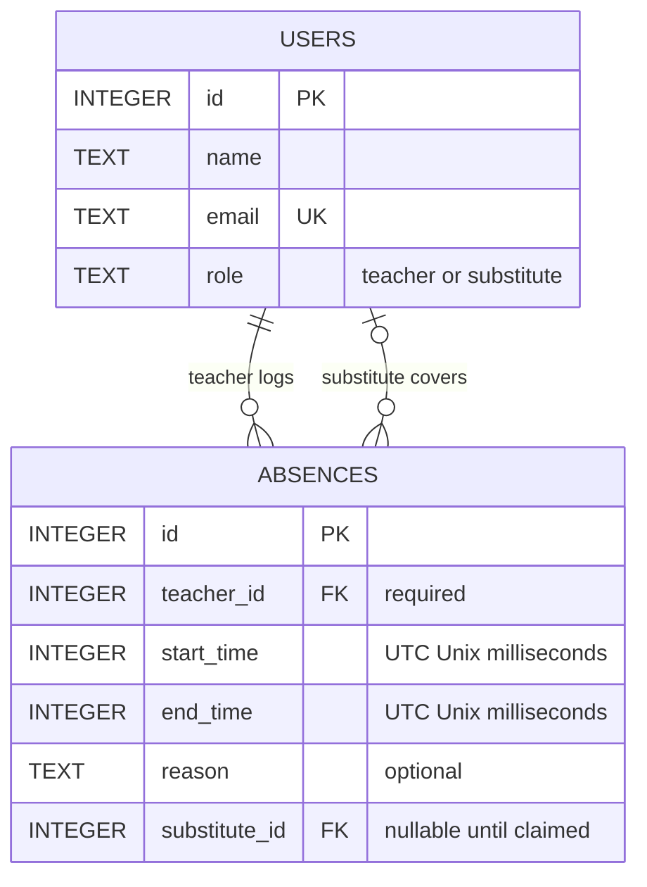

# APS Take-Home — AI Chat Transcript

- **Session:** Project architecture and roadmap
- **Session ID:** `ses_e4c8798dbffejTo3E9MhMbPu82`
- **Tool/model:** OpenCode / OpenAI GPT-6.1 Sol
- **Markdown generated (UTC):** 2026-11-08T21:51:51.153Z
- **Included:** 21 user messages and 49 assistant text blocks, in stored conversation order.

## Export scope

This is a readable conversion of the locally exported OpenCode session, not a newly written summary. It includes the user messages and visible assistant text present in the stored export through the request to create this Markdown transcript. Original wording (including typos and historical proposals later corrected) is retained; only surrounding whitespace is trimmed and speaker/timestamp formatting is added. Timestamps are UTC.

Internal reasoning, system/developer instructions, tool calls/results, file payloads, compaction summaries, and synthetic/status events are intentionally excluded. The source includes compaction metadata; no missing conversation text has been reconstructed. Work still in progress when the snapshot was taken is not included. Historical test counts and pending-task statements describe their point in the conversation, not necessarily the final project state.

The raw session JSON remains outside the repository and is not part of this submission. No public share link was created. An automated credential-pattern check found no common API-key/private-key patterns in the included text; the project owner should still review this transcript before committing or sharing it. See [AI_LOG.md](../AI_LOG.md) for the collaboration summary and final verification evidence.

Supporting documents now live in `docs/`. Document names and links within the historical conversation are preserved as originally written; use the [README documentation index](../README.md#documentation) to locate their current paths.

---
## 1. User

*2026-11-07T00:46:14.984Z*

This will be the session for a takhome project given by APS Data Technologies. We will work together to read the given spec doc (README.md) and complete what is asked. Start by looking at the overall architecture of the project to get a grasp of where everything is then look over the spec doc and gain an understanding of what our goal is. Then create a roadmap that we can take to implement and complete our goal. Keep in mind various different impelemtnations and features and I will also be reading over the various implementations we can do. We will work together by sharing ideas and development. After every change create a agents.md file in which other agents can read and gain context as to what we are doing, what has been done, and what should be done next.

---

## 2. Assistant

*2026-11-07T00:46:30.040Z*

The starter is a small Express + SQLite app with a plain HTML/JavaScript frontend. The spec prioritizes backend correctness, tests, and evidence of our design review—not styling.

Two things will shape the roadmap: claims need atomic conflict checks, and timestamp handling needs an explicit policy. Also, this folder currently has no Git repository, although the submission requires milestone commits; I’ll flag that as a setup step rather than initialize it without your go-ahead.

---

## 3. Assistant

*2026-11-07T00:47:53.730Z*

Reviewed the architecture and specification. Created:
- **`ROADMAP.md`** — implementation options, milestones, API proposal, and test checklist.
- **`agents.md`** — current context, proposed decisions, completed work, and next steps. I’ll update it after each change set.

No application code has changed. Baseline tests pass: **1/1**.

### Current architecture
- `src/server.js`: starts the server.
- `src/app.js`: Express routes and static frontend hosting.
- `src/db.js`: SQLite setup and five seeded users.
- `public/index.html`: vanilla HTML/JS; only the staff directory currently works.
- `tests/api.test.js`: Vitest/Supertest integration tests.

### Our goal
Allow teachers to log absences and substitutes to claim them, while preventing double claims, overlapping substitute schedules, and invalid inputs. The assessment emphasizes **correctness, design review, tests, and honest AI collaboration documentation**, not visual polish.

### Proposed roadmap
1. **Agree on design** and complete `ARCHITECTURE.md` before application code.
2. **Build database/API with tests** for creation, listing, claiming, and rejection cases.
3. **Connect the minimal UI**, including useful error feedback.
4. **Verify and finalize** diagrams, tests, `AI_LOG.md`, and submission packaging.

### Design choices for us to review
My starting recommendations:
- **One absence table**, with a nullable substitute assignment; separate assignment records become useful if we add history or reassignment.
- **Normalized timestamps** with an explicit timezone policy.
- **Atomic claim transactions**, protecting both against double claims and overlapping assignments.
- **Allow back-to-back shifts**; discuss whether overlapping absences for the same teacher should also be rejected.

One setup issue: **this folder has no Git repository**, but submission requires milestone commits. We should initialize Git—with your approval—before implementation.

Next, let’s review those design choices together before filling in the architecture diagrams.

---

## 4. User

*2026-11-07T21:10:14.878Z*

Okay let's start step by step. Since it's specifying the use of git to log important changes let's do that first, then we'll worry about the first step being creating a mermaid of the schema of the system.

---

## 5. Assistant

*2026-11-07T21:10:20.571Z*

I’ll initialize Git on `main`, ignore dependencies and generated database files, and commit the current starter plus planning documents as our baseline. Your Git identity is already configured. We’ll leave the Mermaid schema for the next step.

---

## 6. Assistant

*2026-11-07T21:11:15.733Z*

Git is ready:
- Initialized on **`main`**.
- Added `.gitignore` for dependencies, generated databases, environment files, and logs.
- Created baseline commit **`99650d2`** — `chore: establish starter and planning baseline`.
- Updated `agents.md` and `ROADMAP.md`.
- Working tree is clean; application code is unchanged.

Next, we’ll design and review the Mermaid schema in `ARCHITECTURE.md`.

---

## 7. User

*2026-11-07T21:12:12.974Z*

Okay then, first propose your implementation to me and explani why for your design choices

---

## 8. Assistant

*2026-11-07T21:12:12.991Z*

I recommend extending the existing app rather than introducing a framework, ORM, or additional services. The project is small, and the assessment rewards **reliable business logic and clear reasoning**.

This is a proposal for review—not an implementation yet.

## 1. Database: one new `absences` table

Keep the existing `users` table and add:



Both relationships reference `users`, but serve different purposes:
- `teacher_id`: the teacher who will be absent.
- `substitute_id`: the substitute covering that absence, if assigned.

### Why this model?

**An absence is also the shift needing coverage.** The specification does not require splitting one absence among multiple substitutes, so a separate shifts table would duplicate the same time window.

**One nullable assignment is sufficient.** An absence can have either no substitute or one substitute.

**Status should be derived:**
- `substitute_id IS NULL` → **Open**
- Otherwise → **Claimed**

Storing both `status` and `substitute_id` creates the possibility of contradictory data, such as “Open” with a substitute assigned.

**Alternative:** a separate assignments table would make sense if we needed reassignment history, cancellations, or multiple substitutes per absence. Those are not currently required.

## 2. Constraints: protect data in layers

### Database responsibilities
- Primary keys identify records.
- Foreign keys require referenced users to exist.
- Teacher and timestamps cannot be null.
- A check constraint requires `end_time > start_time`.

### API responsibilities
- Validate IDs and request fields.
- Confirm the teacher actually has the `teacher` role.
- Confirm the claimant has the `substitute` role.
- Validate timestamps before storing them.
- Reject conflicting claims.

**Important distinction:** a foreign key to `users` does not check that user’s role. Cross-table role enforcement would require something additional, such as SQLite triggers.

For this exercise, I recommend **database constraints plus API role validation**, with all application assignments going through one transactional claim operation. Triggers are a stronger alternative if we want these rules enforced against direct database writes too.

## 3. Time handling: normalize before comparing

I propose:
- API accepts ISO timestamps with an explicit timezone.
- SQLite stores integer UTC milliseconds.
- API returns canonical ISO timestamps.
- The browser converts its local date/time inputs before sending them.

**Why:** two timestamps with different timezone offsets can represent the same instant. Numeric normalized values make ordering and overlap checks straightforward.

We should validate actual calendar dates—not merely trust JavaScript’s permissive date parsing.

Use **half-open intervals**: `[start, end)`.

For example:
- 9:00–10:00 and 10:00–11:00 → allowed.
- 9:00–10:01 and 10:00–11:00 → conflict.

The overlap rule is:

```text
existing.start < requested.end
AND
existing.end > requested.start
```

## 4. Claims: check and assign atomically

The claim operation should run inside a **SQLite immediate transaction**:

1. Validate the substitute and locate the absence.
2. Reject an already claimed absence.
3. Check that substitute’s existing assignments for overlap.
4. Assign the substitute using a guarded update.
5. Commit.

**Why a transaction?** Checking availability and assigning in separate operations could allow competing requests to pass the checks before either assignment is saved.

**Why a guarded update too?** Updating only when `substitute_id IS NULL` adds explicit protection against overwriting an assignment.

A guarded update alone is insufficient: it does not stop one substitute taking **two different overlapping absences**.

## 5. API and frontend

Keep the three planned endpoints:

| Endpoint | Purpose |
|---|---|
| `POST /api/absences` | Create an absence |
| `GET /api/absences` | List absences with teacher/substitute names |
| `POST /api/absences/:id/claim` | Claim an open absence |

Use consistent JSON errors:
- `400`: invalid input or actor role.
- `404`: absence not found.
- `409`: already claimed or scheduling conflict.

The frontend stays vanilla HTML/JavaScript: teacher form, substitute selector, coverage board, and visible success/error feedback. No authentication is implied by selecting a user.

## 6. Tests and scope

Prioritize tests for:
- Create → list → claim.
- Invalid users, roles, and times.
- Double claims.
- Partial, contained, and identical overlaps.
- Allowed adjacent shifts and different substitutes.
- Rejected operations leaving assignments unchanged.

I would **not initially add** authentication, cancellation, notifications, or past-date restrictions.

Before we finalize the schema, I’d like your thoughts on three choices:
1. **Single-table assignment** versus a separate assignments table.
2. **Integer timestamps** versus normalized ISO text.
3. Whether to reject **overlapping absences for the same teacher**, beyond the required substitute-conflict rule.

---

## 9. User

*2026-11-07T21:13:38.310Z*

Can you show your implementation in the architecutre markdown using mermaid

---

## 10. Assistant

*2026-11-07T21:13:43.305Z*

I’ll add the proposed schema and claim-flow diagrams to `ARCHITECTURE.md`, marked as a draft for review. I’ll leave the design-corrections section pending so it reflects our actual discussion rather than invented feedback.

---

## 11. Assistant

*2026-11-07T21:14:51.635Z*

Updated **`ARCHITECTURE.md`** with:
- Mermaid ERD for users and absences.
- Mermaid sequence diagram for claiming, validation, and conflicts.
- Design rationale, constraints, and decisions awaiting review.

Also updated **`agents.md`**. No application code changed; the architecture remains an uncommitted draft for us to review.

---

## 12. User

*2026-11-07T21:24:27.422Z*

So I am looking through the ER diagram. In this case is a teacher considered a substitue as well? Since a teacher_id is needed where as a substitute_id can be null? Can readon be more than one word long? Should there be a history behind their absences? Such as a count for that teacher? What happens if the count goes to a substitute that is null? I belive that overlapping absences for the same teacher should be combined into one? Meaning their timestamp. What happens if the substitute also creates an absence? As well as two teachers trying to claim the same substitute, maybe making substitute unique or at least during the same period.

---

## 13. Assistant

*2026-11-07T21:24:27.458Z*

Good questions. The ERD shows the relationships, but several of these rules need to be stated explicitly.

## 1. Is a teacher also a substitute?

**Not in the current model.** Each user has one role: `teacher` **or** `substitute`.

Both IDs reference `users`, but the API checks their roles:
- `teacher_id` must reference a teacher.
- `substitute_id`, when present, must reference a substitute.

The nullable substitute means **“this absence has not been covered yet”**, not that the teacher is also a substitute.

If we wanted teachers to cover other teachers’ classes, we would need to revisit the single-role design.

## 2. Can `reason` contain multiple words?

**Yes.** SQLite `TEXT` can store a sentence or paragraph, such as:

> Medical appointment; coverage needed for afternoon math classes.

Any length limit would be an explicit API policy, not a restriction caused by the database type.

## 3. Should teachers have absence history and counts?

**The absence records already provide basic history**, provided we retain them rather than delete them after the shift.

We can calculate a teacher’s count:

```sql
SELECT COUNT(*)
FROM absences
WHERE teacher_id = ?;
```

I would **calculate this rather than store a counter**, because stored counters can become incorrect after merges or other changes.

A null substitute does not affect this count: the absence still belongs to its teacher. Counting assigned substitutes is a different query—`COUNT(substitute_id)` deliberately excludes null assignments.

One important distinction: after merging absences, the count represents **absence records/windows**, not the number of times someone submitted the form. Tracking every submission or edit would require a separate audit history.

## 4. Should overlapping teacher absences merge?

That is reasonable. For the same teacher:

```text
Existing: 09:00–12:00
New:      11:00–14:00
Combined: 09:00–14:00
```

However, **merging becomes dangerous once coverage is assigned**. A substitute who accepted 09:00–12:00 should not silently become responsible until 14:00.

My recommendation:
- Merge overlapping **open** absences for the same teacher.
- Include all overlapping records affected by the combined window.
- Preserve their reasons rather than silently discard information.
- Reject the operation with `409` if an affected absence is already claimed.
- Keep adjacent, non-overlapping windows separate unless we decide otherwise.

This is a refinement to the original proposal and should be documented in our design review.

## 5. What if a substitute creates an absence?

Under the current requirements, **the API rejects it**, even if someone bypasses the frontend and sends a request directly.

The task specifically describes teacher absences. Supporting substitute unavailability would be a separate feature—probably an availability/unavailability model rather than pretending substitutes are teachers.

## 6. What about two teachers needing the same substitute simultaneously?

The specified workflow is **substitutes claiming absences**, rather than teachers assigning substitutes. Nevertheless, the underlying conflict must be prevented either way.

We should **not make `substitute_id` globally unique**. That would prevent a substitute from covering more than one absence ever.

Instead, enforce:

> A substitute can cover many absences, but their time windows cannot overlap.

The transactional overlap check handles competing claims: the first valid assignment succeeds; a conflicting assignment receives `409`. This works whether the absences belong to the same or different teachers.

---

**The main decision to settle:** shall we merge overlapping **open** teacher absences, but reject overlaps involving any **claimed** absence? That avoids silently changing a substitute’s commitment.

---

## 14. User

*2026-11-07T21:30:21.074Z*

Yes, that sounds most logically correct. We can merge overlapping open teacher absences bu cannot merge overlaps involving claimed absences with substitutes?

---

## 15. Assistant

*2026-11-07T21:30:26.232Z*

Yes—merge overlapping **open absences for the same teacher**, but return `409 Conflict` if any affected absence is already claimed. The rejection must leave all records unchanged, so a substitute’s agreed hours never expand silently.

I’ll record that decision in the architecture and roadmap; no application code changes yet.

---

## 16. Assistant

*2026-11-07T21:31:27.338Z*

Exactly—for the **same teacher**:

- **Overlapping open absences:** merge into one window using the earliest start and latest end.
- **Any overlap involving a claimed absence:** reject with `409 Conflict`, leaving all records and assignments unchanged.

This prevents silently extending a substitute’s agreed hours. Different teachers’ absences are never merged.

Recorded this decision in `ARCHITECTURE.md`, `ROADMAP.md`, and `agents.md`. No application code changed.

---

## 17. User

*2026-11-07T21:33:48.684Z*

Okay so what is left for me to review for the first step?

---

## 18. Assistant

*2026-11-07T21:33:48.707Z*

The main business rule is settled. These are the remaining choices before we finalize Step 1:

### 1. Schema
**Recommendation:** keep one `absences` table with an optional `substitute_id`, and derive Open/Claimed status from that assignment.

A separate assignments table is only necessary if we want reassignment history or multiple substitutes.

### 2. Time handling
**Recommendation:**
- Accept ISO timestamps with a timezone.
- Store UTC milliseconds.
- Allow back-to-back shifts.
- Keep adjacent teacher absences separate; merge only genuinely overlapping ones.

The browser handles conversion from local date/time inputs.

### 3. Merge details
We agreed **when** to merge; we still need to choose **how**:
- **Record ID:** recommend retaining the lowest existing absence ID and removing the other merged records.
- **Reasons:** recommend preserving distinct, non-empty reasons, separated by newlines.
- **History:** merging consolidates records; it does not preserve a full submission/edit history. Is that sufficient for our scope?

### 4. API responses
**Recommendation:**
- `201` for a newly created absence.
- `200` when merged into an existing absence.
- `400` for invalid input.
- `404` for a missing absence.
- `409` for scheduling or claim conflicts.

Both creation and merging return the resulting absence.

### 5. Enforcement boundaries
**Recommendation:** database constraints for references and valid time windows; API role validation; immediate transactions for merges and claims.

This protects application requests. Adding database triggers would additionally protect against someone bypassing the API with direct SQL writes.

---

The Mermaid diagrams and **two genuine design corrections** are already documented. Once we settle these choices, we can finalize `ARCHITECTURE.md`, record the discussion in `AI_LOG.md`, and create the architecture milestone commit—before writing application code.

---

## 19. User

*2026-11-07T21:38:55.257Z*

Would it not be ideal to have multiple substitues? I want this system to be scalable even if the project itself has a small scope. For the time handling would we not be able to use julian? Or is ISO timestmap the best/easiest to work with? Is storing in milliseconds the best? I belive normal seconds would not cause a huge change. I belive that back to back shifts would have to be allowed if we're taking into consideration substitutes. Yes, adjacent teacher absences should be separate. Wait but what if the two overlapping merges have different reasons? Should they be considered non mergable or should we combine the reasons? I aggree with the recommended API responses. Yes, I belive we should have enformcement boundaries especially for security reasons.

---

## 20. Assistant

*2026-11-07T21:39:14.010Z*

Back-to-back substitute shifts, separate adjacent teacher absences, and the proposed HTTP responses are now agreed. I’ll record those decisions.

The main distinction still to resolve is whether “multiple substitutes” means a larger staff pool—which the current design supports—or splitting one absence between substitutes. Splitting coverage changes both the schema and the meaning of “Claimed.”

---

## 21. Assistant

*2026-11-07T21:40:23.085Z*

## 1. Multiple substitutes and scalability

There are two different meanings:

- **Many substitutes in the system:** already supported.
- **Several substitutes splitting one absence:** requires additional design.

For example:

```text
Teacher absence: 09:00–15:00
Substitute A:    09:00–12:00
Substitute B:    12:00–15:00
```

Your scalability concern is valid. **I now recommend a separate `assignments` table**, separating the teacher’s absence from its coverage.

However, I recommend initially enforcing **one assignment per absence**, matching the assessment’s whole-shift claim requirement. This keeps implementation manageable while making future split coverage easier to introduce.

Actual split coverage would additionally require:
- Assignment start/end times.
- Preventing overlapping coverage within an absence.
- Detecting uncovered gaps.
- A **Partially Covered** status.
- A UI for selecting portions of a shift.

Simply allowing several substitutes to claim the entire absence would undermine double-claim prevention. Also, a separate table improves extensibility; it does not automatically provide audit history.

## 2. ISO, Julian dates, and seconds

**ISO is the API representation; Unix or Julian values are storage choices.** We can use ISO externally and numeric values internally.

| Representation | Assessment |
|---|---|
| ISO timestamps | Readable, standard, convenient for browser/API communication |
| Julian-day numbers | Supported by SQLite, but usually floating-point and less convenient in JavaScript |
| Unix seconds | Simple integer ordering and overlap calculations; sufficient scheduling precision |
| Unix milliseconds | Matches JavaScript’s native timestamp unit, but unnecessary precision here |

You are right: **seconds are sufficient for this project**. My original milliseconds recommendation was primarily for JavaScript convenience, not because scheduling requires it.

I recommend **ISO input/output and integer UTC seconds in SQLite**. We should explicitly decide how fractional-second inputs behave—preferably reject non-zero fractions rather than silently truncate boundaries.

## 3. Adjacent shifts

Agreed:
- Substitutes may work back-to-back shifts.
- Adjacent teacher absences remain separate.
- Only genuine overlaps trigger merging.

## 4. Different reasons during a merge

I recommend **combining the reasons**, not rejecting the merge.

The time window determines whether the teacher needs coverage; different descriptions do not change that fact.

For example:

```text
09:00–12:00: Medical appointment
11:00–14:00: Personal leave
```

The combined absence becomes 09:00–14:00, preserving both descriptions.

A simple newline-separated list is sufficient if we only need the explanations. If we need to retain **which reason applied to which original window**, we should preserve structured source records instead. Concatenated text is not a complete history.

## 5. Enforcement and security

Agreed on layered enforcement:
- Database constraints protect structural integrity.
- Backend validation checks roles and inputs.
- Transactions protect concurrent operations.
- Parameterized SQL and safe text rendering reduce injection risks.

**These are not authentication.** With selectable user IDs, someone can still impersonate another seeded user. Production security would require identifying the logged-in user and authorizing their actions.

I recorded the approved decisions and remaining questions in the architecture, roadmap, and handoff documents.

**Shall we adopt a separate assignments table now, while retaining one whole-absence assignment initially?** That is my recommended balance between extensibility and completing the assessment reliably.

---

## 22. User

*2026-11-07T21:47:00.251Z*

Yes, let's move on with the assignments table. In the real world it is definetely possible for multiple substitutes to split a teachers work hours. I belive it would make sense to have this implemented for our system. Let's go with the recommended timestamp contract, however if UTC Unix milliseconds is easier to work with in JavaScript then let's go with that if it doesn't have such a huge impact in the system. I belive you are correct with the merge details. Let's preserve the distinct reasons

---

## 23. Assistant

*2026-11-07T21:47:00.297Z*

I’ll revise the architecture for split coverage: each assignment will have its own substitute and time window. An absence will be Open, Partially Covered, or Claimed (fully covered), and any existing assignment will block a teacher-absence merge.

We’ll use UTC milliseconds for JavaScript convenience and preserve distinct reasons when merging. Split coverage expands the original scope, so I’ll document the new conflict rules and tests before application code.

---

## 24. Assistant

*2026-11-07T21:50:14.794Z*

Updated `ARCHITECTURE.md` with the revised Mermaid schema and flows:

- **`assignments` table:** each assignment has its own substitute and time window, enabling real split coverage.
- **Derived status:** Open → Partially Covered → Claimed when no gaps remain.
- **Conflict checks:** prevent double coverage of an absence and overlapping assignments for a substitute.
- **Merge protection:** any assignment—even partial coverage—blocks merging.
- **Timestamps:** ISO input/output, UTC milliseconds internally; negligible impact and convenient for JavaScript.
- **Reasons:** preserve distinct descriptions. Proposed storage is a JSON array.

Also updated `ROADMAP.md`, `agents.md`, and began the factual `AI_LOG.md`.

The revised diagrams are ready for final review before we commit the architecture milestone. No application code has changed.

---

## 25. User

*2026-11-07T22:01:57.579Z*

Yes, preserve the lowest existing ID when merging. Would it not be best to truncate every timestamp up to milliseconds? What if they are valid timestamps with valuable data or information and we just reject them? Yes, let's keep the structural integrity, ALso for the Claim transaciton section I am seeing an error saying:
Parse error on line 49:
...le board after a 409
-----------------------^
Expecting '()', 'SOLID_OPEN_ARROW', 'DOTTED_OPEN_ARROW', 'SOLID_ARROW', 'SOLID_ARROW_TOP', 'SOLID_ARROW_BOTTOM', 'STICK_ARROW_TOP', 'STICK_ARROW_BOTTOM', 'SOLID_ARROW_TOP_DOTTED', 'SOLID_ARROW_BOTTOM_DOTTED', 'STICK_ARROW_TOP_DOTTED', 'STICK_ARROW_BOTTOM_DOTTED', 'SOLID_ARROW_TOP_REVERSE', 'SOLID_ARROW_BOTTOM_REVERSE', 'STICK_ARROW_TOP_REVERSE', 'STICK_ARROW_BOTTOM_REVERSE', 'SOLID_ARROW_TOP_REVERSE_DOTTED', 'SOLID_ARROW_BOTTOM_REVERSE_DOTTED', 'STICK_ARROW_TOP_REVERSE_DOTTED', 'STICK_ARROW_BOTTOM_REVERSE_DOTTED', 'BIDIRECTIONAL_SOLID_ARROW', 'DOTTED_ARROW', 'BIDIRECTIONAL_DOTTED_ARROW', 'SOLID_CROSS', 'DOTTED_CROSS', 'SOLID_POINT', 'DOTTED_POINT', got 'NEWLINE'

---

## 26. Assistant

*2026-11-07T22:02:10.684Z*

Yes—we can accept valid higher-precision timestamps and truncate the fractional seconds to milliseconds. That avoids rejecting otherwise usable input, but it does discard sub-millisecond information; it isn’t lossless. We’ll return the normalized values and reject any interval that collapses to zero duration after truncation.

I’ll record the lowest-ID decision and reproduce the Mermaid error before fixing it.

---

## 27. Assistant

*2026-11-07T22:04:08.995Z*

I reproduced the exact Mermaid error. The semicolon in the final note was treated as a statement separator, so I replaced it with “and.” All three diagrams now pass Mermaid 11 parsing. The validation tools were installed outside the project; its dependencies are unchanged.

---

## 28. Assistant

*2026-11-07T22:04:32.414Z*

**Fixed the Mermaid error.** The semicolon in the final note broke parsing. All three diagrams now pass Mermaid 11 syntax validation.

Recorded:
- Preserve the **lowest existing ID** during merges.
- Keep database constraints and transactional API checks.
- Accept valid higher-precision timestamps and **truncate fractional seconds to milliseconds**.

For example:

```text
09:00:00.123456Z → 09:00:00.123Z
```

Truncation is reasonable for school scheduling, but it **discards sub-millisecond information**. If that information becomes important, we would need higher-precision storage or retain the original input.

We’ll validate the complete timestamp before truncating, then check duration and conflicts afterward. An interval that collapses to zero duration will still receive `400`.

Updated `ARCHITECTURE.md`, `ROADMAP.md`, `AI_LOG.md`, and `agents.md`. No application code or project dependencies changed.

---

## 29. User

*2026-11-07T22:09:26.610Z*

What other things are to consider and any edge cases or other use cases that I or we haven't thought about that can either break or bug our implementation? It's good to take a step back, look over our implementation and think about real use cases that are not possible currently or can be possible

---

## 30. Assistant

*2026-11-07T22:09:59.330Z*

One important gap is a stale whole-shift claim: if a merge expands an absence while a substitute is viewing the old hours, an ID-only claim could assign the expanded hours without their knowledge.

I’ll separate correctness risks we should test now from production features we can document as limitations, rather than expand the scope automatically.

---

## 31. Assistant

*2026-11-07T22:11:27.186Z*

Yes. Stepping back reveals several important cases—especially now that we support merging and split coverage.

**We’re reviewing the design, not a completed implementation:** the feature code and its tests haven’t been written yet. I recorded this review in **`DESIGN_REVIEW.md`**.

## Highest-priority failure cases

### 1. A stale screen could change what a substitute accepts

Consider:

1. A substitute sees absence ID 1: **09:00–12:00**.
2. A teacher submits an overlapping absence.
3. The merged absence keeps ID 1 but becomes **09:00–15:00**.
4. The substitute clicks “Claim” on their old screen.

If the request only contains the substitute ID, the server could assign **09:00–15:00** without the substitute seeing those hours.

**Recommendation:** require explicit start/end times for every claim. Never silently expand the submitted window. A version check is another option if any change to the absence should require renewed confirmation.

### 2. Simultaneous requests need several different tests

We must test more than two substitutes claiming the same absence:

| Competing operations | Expected result |
|---|---|
| Different substitutes claim overlapping portions of one absence | Only one succeeds for the contested time |
| One substitute claims overlapping portions of different absences | Only one succeeds |
| Different substitutes claim adjacent portions | Both can succeed |
| A teacher merges while a substitute claims | No accepted assignment is expanded or deleted |

We also need **rollback tests**: if a merge fails halfway through, its dates, reasons, and records must all remain unchanged.

### 3. “Has assignments” does not mean fully covered

For an absence of **09:00–15:00**:

```text
Substitute A: 09:00–11:00
Substitute B: 12:00–15:00
Missing:      11:00–12:00
```

Checking only the earliest start and latest end would incorrectly report full coverage.

**Recommendation:** calculate every uncovered gap from ordered assignments. Test missing time at the beginning, middle, and end.

Also, a request spanning an already covered section must be rejected—not silently divided into smaller assignments.

### 4. One submission can merge several existing absences

```text
Existing: 09:00–10:00
Existing: 11:00–12:00
New:      09:30–11:30
Result:   09:00–12:00
```

The merge must find **all affected records**, preserve the lowest ID and distinct reasons, and reject everything if even one affected absence has coverage.

We must not merge one open record first and only afterward discover another protected record.

## Time and browser issues

### 5. UTC does not eliminate every timezone problem

Important cases include:
- Two different offsets representing the same instant.
- Overnight or multi-day absences.
- Impossible dates that JavaScript might automatically normalize.
- Daylight-saving changes, when a local time can occur twice—or not exist.
- A teacher using a browser in a different timezone from the school.

**Recommendation:** clearly display the timezone being used. Browser-local time is convenient for the exercise, but a real district system would likely need a configured school timezone.

Our truncation policy also means:
- Some tiny intervals collapse to zero milliseconds and must be rejected.
- Sub-millisecond distinctions are intentionally lost.
- Every endpoint must normalize consistently before checking conflicts.

## Recovery and security

### 6. A failed response does not necessarily mean a failed claim

The database could commit successfully, but the network response could be lost.

The substitute retries and receives `409`, even though their first request actually succeeded.

**Recommendation:** refresh current assignments after ambiguous failures. Prevent duplicate clicks, but never depend on disabled buttons for backend correctness. Durable idempotency keys are a possible later improvement.

### 7. Reason text introduces privacy and input risks

Reasons might contain:
- Multiple paragraphs or Unicode.
- HTML-like text or quotes.
- Extremely long content.
- Sensitive medical information.

We should safely render text, parameterize SQL, validate types and sizes, and preserve valid reasons without corrupting their boundaries.

**Production concern:** everyone should not automatically see everyone else’s medical details. Our selected-user model has no real authentication or privacy controls.

## Real-world workflows we deliberately don’t support yet

- **Substitute cancellation:** reopening coverage needs an authorized unclaim/reassignment workflow.
- **Teacher returning early:** accepted coverage needs a deliberate change process.
- **Past shifts:** historical absence entry may be useful, but should someone be able to claim an already-ended shift?
- **Lunch breaks:** currently the entire absence window requires coverage, including any breaks.
- **Travel between schools:** back-to-back shifts may be mathematically valid but physically impossible.
- **Qualifications and availability:** we don’t check certification, unavailable periods, or workload limits.
- **Full audit history:** merging preserves reasons, not every original submission or its reason-to-time mapping.
- **Heavy concurrency:** the assignments model is extensible, but SQLite still permits only one writer at a time.

## My recommendation

Before coding, settle two remaining behavioral questions:

1. **Require explicit times for every claim** to protect against stale commitments.
2. Decide whether to **reject claims for expired shifts**, separately from allowing historical absence records.

Then build and test the core correctness cases above. Document the other limitations rather than automatically expanding the take-home into a production scheduling platform.

---

## 32. User

*2026-11-07T22:26:45.619Z*

Yes, we should not have stale information so I belive your recommendation of requireing explicit start/end times for every clain is definitely required. Yes, rollback is important, we should have a rollback before we do anything like merging or changing data. Would this calcuating every undoverwed gap add time complexity to our system? How efficient would it be on finding open time in the middle? What if there are two gaps or more? The same question for finding all affected records. I do belive these are problems we do need to take into considration but I am not sure as to how they would be implemented or the most efficient solution. Yes, we should clearly display the timezone used. Yes, we should worry about recover and prevent duplicate clicks especially when network can be lost between transactions. I don't think we need to worry as much on security or at least for the reason text privact. I agree on your real world workfows. The system should allow for substitutes to cancel which should reopen coverage, teachers should also be allowed to return early which would change the times for substitutes or even get them of the job, No I belive people should not be able to claim an already eneded shift, I think it can be implied for breaks such as a teacher putting a time of 9 - 12 or something, but I guess if they put like 9 - 4 it wouldn't take into consideration of breaks, what do you think we should do here? I don't think we have to worry about back to back shifts, would a substitute even be able to hold something like a certification, unabailable periods, or workload limits? Wouldn't that cause a huge increase in information for the schema? What do you think? I think it would be good to have a substitute that we know has a cirtification. I don't think we need a full audit history for now. We should focus on any concurrency problems which might affect data being written or shown.

---

## 33. Assistant

*2026-11-07T22:27:45.365Z*

The gap calculation is a linear scan of one absence’s ordered assignments, so it can find any number of gaps without checking every possible time slot.

One correction on rollback: we **begin a transaction before changes**, then commit if all checks and writes succeed, or roll back on failure. Cancellation and early return should use that same boundary. I’ll record the approved requirements and keep the remaining break/certification choices clearly marked as proposals.

---

## 34. Assistant

*2026-11-07T22:30:25.967Z*

Yes—these are manageable, but we should separate **efficient algorithms**, **transaction safety**, and **new business rules**.

## 1. Rollback: begin first, undo only on failure

One clarification: we don’t roll back before making changes. We:

1. Begin a transaction.
2. Read the current records and validate.
3. Apply all related changes.
4. Commit if everything succeeds.
5. Roll back **all changes** if anything fails.

That applies to merging, claiming, cancellation, and early return. A merge must never leave updated dates but undeleted duplicate records, for example.

## 2. Finding every gap is efficient

We don’t check every minute or compare every assignment against every other assignment.

We retrieve one absence’s assignments ordered by start time and scan them once:

```text
Absence:    09:00–17:00
Assigned:   09:00–10:00
Assigned:   11:00–12:00
Assigned:   14:00–17:00

Gaps:       10:00–11:00
            12:00–14:00
```

The algorithm keeps a cursor at the end of coverage seen so far. Whenever the next assignment starts after that cursor, we have found a gap.

For **k assignments**, calculating all gaps takes **O(k)** time. Two gaps or twenty gaps use the same algorithm. Producing the gap list necessarily takes time proportional to its size.

An index on `(absence_id, start_time)` supports retrieving the assignments in order. We only recalculate the affected absence after a change—not every absence in the system.

**No custom interval tree is necessary here.**

## 3. Finding records affected by a merge

The straightforward query is:

```text
Same teacher
AND existing start < submitted end
AND existing end > submitted start
```

An index beginning with `(teacher_id, start_time)` helps, although it does not magically make every overlap query logarithmic: old records may still need filtering.

There is a tighter option because our application maintains **non-overlapping absences for each teacher**:

- Check the nearest interval starting before the submitted start.
- Retrieve intervals starting inside the submitted window.

Those are the possible matches. With the index, retrieval is approximately **O(log t + m)**, where `t` is that teacher’s record count and `m` is the number of matches, plus the necessary updates.

**Recommendation:** start with the clear indexed overlap query. Optimize only if measurement warrants it; preserve the non-overlap invariant either way.

## 4. Cancellation and early return

These should be explicit operations—not exceptions to the merge rules.

### Substitute cancellation

My recommended behavior:

- **Future assignment:** remove it and reopen its window.
- **Assignment already underway:** preserve the elapsed portion and release only the remainder.
- **Ended assignment:** don’t rewrite historical coverage through cancellation.

Example: cancelling 09:00–12:00 at 10:00 retains coverage for 09:00–10:00 and reopens 10:00–12:00.

### Teacher returns early

For a 09:00–16:00 absence shortened to 13:00:

| Existing assignment | Result |
|---|---|
| 09:00–12:00 | Unchanged |
| 12:00–14:00 | Shortened to 12:00–13:00 |
| 14:00–16:00 | Removed |

The absence and every affected assignment change **in one transaction**. Time after 13:00 is no longer needed, so it should not reopen as available coverage.

These are proposed mechanics for the workflows you approved.

## 5. Breaks: don’t infer information we weren’t given

A 09:00–16:00 absence does not tell us whether lunch is 12:00–12:30, 12:30–13:00, or requires coverage.

**My recommendation:** represent known breaks with separate absence windows:

```text
09:00–12:00 — coverage needed
12:00–13:00 — no absence window
13:00–16:00 — coverage needed
```

Our existing model supports this without another table. A continuous 09:00–16:00 submission means continuous coverage is needed.

Later, a school timetable could generate those windows automatically. We should not silently assume breaks now.

## 6. Certification does not require a huge schema

Certification, availability, and workload are separate capabilities. We don’t need all three together.

A small certification table could contain:

```text
substitute_id
credential
expires_at   [optional]
```

That supports several credentials per substitute without adding many columns to `users`.

However, distinguish:

- **Displaying recorded credentials:** relatively small addition.
- **Enforcing eligibility:** also needs absence qualification requirements, expiry rules, and a way to establish that credentials were verified.

**Recommendation:** begin with visible certification metadata. Keep availability calendars and workload limits deferred. We should not infer qualifications from names such as “Alice (Math).”

## 7. Concurrency affects reads too

Transactions protect writes, but the board could also become internally inconsistent if it reads absence dates before an early return and assignments afterward.

**Recommendation:**
- Assemble each board response from one consistent database snapshot.
- Keep transactions short.
- Require explicit claim times.
- Refresh after changes, conflicts, and ambiguous network failures.
- Disable pending controls.
- Test separate database connections competing over the same file.

A snapshot is consistent **at one moment**; it cannot guarantee the browser stays permanently current. We should show timezone and last-updated information rather than imply otherwise.

---

I recorded these decisions and proposals in the planning documents. The revised Mermaid diagrams still pass syntax validation.

**My suggested priority:** finish cancellation/early-return semantics, implement the transaction and interval tests, then add lightweight certification metadata. Keep breaks explicit and avoid expanding into a complete school-calendar or workforce-management system.

---

## 35. User

*2026-11-07T22:37:52.970Z*

I see for the rollback and finding every gap, we should move on with those implementations. Let's go with your recommnedation on finding records affected by a merge. I agree with your recommended implementation for cancellation. I agree with the certification, we should have a small table or at least the metadata. Let's do your recommnedations for concurrency. Let's take a final look at our architecture and move on to the next step

---

## 36. Assistant

*2026-11-07T22:37:53.004Z*

I’ll reconcile the final architecture with the decisions we’ve made, check the diagrams, and commit that milestone. Then I’ll start the database/API implementation with tests, prioritizing transaction safety, gap calculation, and concurrent updates.

---

## 37. Assistant

*2026-11-07T22:38:00.820Z*

The final review doesn’t call for another scheduling table beyond certification metadata. I’ll keep certifications informational, use the simple indexed overlap query, and calculate gaps with a linear scan.

Two implementation defaults: ended windows cannot be claimed, but an in-progress window remains allowed; early return is a separate, atomic shortening operation—not a merge. Missing return time will mean “return now,” while claims will always require explicit times.

---

## 38. Assistant

*2026-11-07T22:45:55.794Z*

The database/API now passes 71 tests covering split coverage, multiple gaps, merging, cancellation, early return, timestamp normalization, and forced rollback failures.

Next I’m checking it across separate processes sharing one SQLite file. That will exercise writer contention rather than relying only on requests through one in-memory connection.

---

## 39. Assistant

*2026-11-07T22:49:46.090Z*

All 84 tests pass, including the separate-process cases for competing claims, merges, cancellations, early returns, coherent board reads, and lock contention.

The final review also caught a timestamp round-trip edge case: UTC conversion near year zero can produce an expanded-year ISO value that the original parser couldn’t read back. That’s fixed and regression-tested. I’m updating the handoff and AI log before committing the backend milestone; the frontend is still the next step.

---

## 40. Assistant

*2026-11-07T22:53:35.798Z*

**Architecture finalized and Step 2—the database/API—is complete.**

Implemented:
- Split coverage with assignments and calculated gaps.
- Overlap merging that preserves the lowest ID and distinct reasons.
- Explicit-time claims, conflict prevention, and expiry checks.
- Cancellation and atomic teacher early return.
- Informational certification metadata.
- Transaction rollback, consistent read snapshots, and structured errors.

**Validation:** 84 tests pass, including separate-process concurrency and forced-failure rollback tests. All Mermaid diagrams pass syntax checks.

Commits:
- `512f9ab` — reviewed architecture.
- `2e19f21` — database/API implementation.

`agents.md`, architecture, roadmap, and AI log are updated. Working tree is clean.

**Next: Step 3—connect the frontend.** It is still the starter shell; we’ll add the forms, coverage board, lifecycle controls, timezone display, and network-recovery behavior.

---

## 41. User

*2026-11-07T23:03:25.319Z*

Yes, if all the tests are passing and everything is correctly implemented following the architecutre then lets move on to the frontend

---

## 42. Assistant

*2026-11-07T23:03:25.406Z*

I’ll connect the frontend to the tested API, keeping the existing styling. I’ll focus on clear coverage gaps, explicit claim times, cancellation/early-return controls, timezone display, and recovery after failed requests. Passing tests are a strong baseline; I’ll also check the browser flows once the UI is connected.

---

## 43. Assistant

*2026-11-07T23:03:50.335Z*

The frontend will remain plain HTML/JavaScript with no build step. I’ll move its behavior into `public/app.js` for readability and add JSDOM as a test-only dependency so UI interactions can be tested against the real API. Browser automation isn’t installed here, so I’ll check whether an isolated headless-browser run is available too.

---

## 44. Assistant

*2026-11-07T23:14:02.692Z*

The first 22 DOM/API integration tests pass. They cover split claims, cancellation, early return, stale conflicts, lost responses, disabled controls, safe text rendering, and daylight-saving edge cases.

Chromium also runs successfully. I’ll now check the served UI in a real browser, including two-page conflicts and a response lost after the server commits. The dependency audit flags six findings in the existing Vitest/Vite development toolchain; I’ll document those rather than force a major-version upgrade during this UI task.

---

## 45. Assistant

*2026-11-07T23:19:15.430Z*

The real-browser checks passed. They verified split coverage, cancellation, early return, two-page conflicts, recovery from a committed write’s lost response, and daylight-saving handling.

Browser testing caught one issue the DOM tests couldn’t: the staff table pushed the page wider than a phone screen. A small grid-width fix resolved it. All 108 automated tests now pass; I’m updating the docs and preparing the frontend milestone commit.

---

## 46. Assistant

*2026-11-07T23:24:05.908Z*

**Frontend is complete**, committed as `fa00773`.

Includes:
- Absence creation, assignments, and coverage gaps.
- Explicit-range claims, cancellation, and early return.
- Certification metadata and timezone previews.
- Pending controls, safe rendering, and network-error recovery.

**Verified:** 108 tests pass, plus Chromium desktop/mobile checks covering conflicting tabs, lost responses, and daylight-saving cases. Working tree is clean; documentation and `agents.md` are updated.

Run `npm run dev`, then open **http://localhost:3000**. Follow `DEMO.md` for the walkthrough.

Known follow-up: six development-tool audit findings remain, including critical findings; the production-dependency audit reports zero. Submission cleanup has not been performed.

---

## 47. User

*2026-11-07T23:29:28.434Z*

Okay can you make some changes to the front end. First, when a user is choosing a datea and time can you not include the  milliseconds as no one is going to input the milliseconds, it should be just the Month, Day, Hour, Minute, and second. Can you do it similar to goodle calandar where you choose in a interval of lets say 30 or 15 minutes and if the user wants they themselves can double click on the time and change the time if they want a more specific time. Also, do not make the pre selected time the current time, but instead start from zero and allow the user to choose themselves

---

## 48. Assistant

*2026-11-07T23:29:28.498Z*

I’ll replace the combined date/time fields with a date picker and 15-minute time choices, starting at `00:00` rather than the current time. Double-clicking the time—or using an accessible edit button—will allow entry down to seconds. I’ll also remove milliseconds from displayed times while keeping the API’s timestamp storage unchanged.

---

## 49. Assistant

*2026-11-07T23:36:21.374Z*

The revised controls pass the browser checks, including real double-click editing down to seconds. New fields show a blank date and `00:00`; claim times are filled only after the user chooses a coverage gap.

All 118 tests pass. Unchanged API gap boundaries still retain their exact stored timestamp and DST offset internally, so hiding milliseconds won’t silently shift existing coverage.

---

## 50. Assistant

*2026-11-07T23:39:25.413Z*

Updated and committed as `d21495c`:

- Removed milliseconds from visible times and inputs.
- Added **15-minute time choices**.
- Double-click the time—or use **Edit exact time**—to enter seconds.
- New fields start with **blank dates and `00:00`**, not the current time.
- Choosing a coverage gap explicitly fills its known bounds.

**Verified:** 118 tests pass, plus desktop/mobile Chromium checks. Documentation and `agents.md` are updated; working tree is clean.

---

## 51. User

*2026-11-07T23:41:28.169Z*

Can you add a PM AM option so the user doesn't have to translate into miliatary time

---

## 52. Assistant

*2026-11-07T23:41:28.238Z*

I’ll change the time choices to labels such as `9:15 AM` and make exact-time editing use a 12-hour clock with an explicit AM/PM selector. The API timestamps and timezone handling will stay unchanged.

---

## 53. Assistant

*2026-11-07T23:45:09.404Z*

AM/PM now appears in the time choices, previews, and coverage board. Exact-time editing has a separate AM/PM selector, with midnight shown as `12:00 AM`.

The 131-test suite passes. Browser checks also confirmed that entering `1:30:05 PM` sends the correct timestamp without changing timezone or daylight-saving behavior.

---

## 54. Assistant

*2026-11-07T23:47:47.205Z*

Added AM/PM throughout the frontend:
- Time choices show labels like **1:15 PM**.
- Exact-time editing includes an **AM/PM selector**.
- Midnight defaults to **12:00 AM**; previews and the board use 12-hour time.

**131 tests pass**, plus browser checks. Updated `agents.md` and docs.

Committed as `0770435`; working tree is clean.

---

## 55. User

*2026-11-07T23:51:10.404Z*

Okay it looks good. What would be next now?

---

## 56. Assistant

*2026-11-07T23:51:10.482Z*

**Next is final acceptance review and submission preparation—not more features.**

1. **Check against `README.md`**
   Confirm every requirement and deliverable is covered: architecture diagrams, design corrections, API/UI, tests, AI log, and Git milestones.

2. **Do a final walkthrough**
   Follow `DEMO.md`: create, merge, split coverage, reject conflicts, cancel, and return early. We already have 131 passing tests and browser checks.

3. **Resolve the known tooling issue**
   The starter’s development-test dependencies have six audit findings, including critical ones. We should decide whether to upgrade and retest them before submission. Production dependencies currently report zero findings.

4. **Package only after your approval**
   Remove `node_modules/`, generated `school.db` and sidecars, then zip the project **including hidden `.git`**. We haven’t performed cleanup yet.

**I recommend doing the final README compliance check next**, then handling the dependency decision before packaging.

---

## 57. User

*2026-11-08T21:24:58.897Z*

I was following the DEMO.md file and I had a absence from Alice Henderson from Nov 16, 12:00 AM - Nov 18, 11:00 AM. I then tried adding another absense for Alice Henderson at Nov 14, 10:00 AM - Nov 16, 12:00 AM. I has testing the merging function in which the front end said it successfully merged the two absense. However, when I look at the absences logs I see two different logs for the two absences. I thought that by merging one of the absence logs would be deleted and removed and would take the lowest ID? However, in this case both absences are still together and instead the higher ID being 4 is shown before the lowest ID being 3. For more context, There is 1 assignee being David Kim from Nov 16, 12:00 PM - Nov 18, 11:00 AM. The rest of the time is uncovered. Can you look into this bug, if it's either a backend or frontend bug

---

## 58. Assistant

*2026-11-08T21:24:58.946Z*

I’ll inspect the stored records and the create/merge response without changing your data. The two ranges you described meet at exactly midnight, so under our agreed rules they’re adjacent, not overlapping; the existing assignment would also block an actual merge. I’ll check why the UI reported a merge and confirm how the board is ordered.

---

## 59. Assistant

*2026-11-08T21:26:55.182Z*

The stored data matches your description: #4 ends exactly when #3 starts, and #3 has David’s assignment. Keeping both is correct. #4 appears first because the board is sorted by start date, not ID.

I reproduced a misleading message: resubmitting #4 returns `200`, and the UI calls every `200` create response “Merged,” even when nothing changed. That could explain what you saw, though we have no submission history to confirm it. I’ll distinguish creation, updates, unchanged submissions, and actual record consolidation in the feedback. Your saved records will remain untouched.

---

## 60. Assistant

*2026-11-08T21:30:45.720Z*

The exact November case now passes API, UI, and real-browser regressions. Genuine overlap with covered #3 is rejected; adjacent #4 remains separate.

The feedback now reports whether a request created, updated, or left an absence unchanged. When existing records truly consolidate, it names the surviving ID and the removed IDs. All 136 tests pass; none of these checks modified your saved demo database.

---

## 61. Assistant

*2026-11-08T21:33:46.645Z*

**I found misleading frontend feedback—not a failed database merge.**

Your saved records confirm:
- **#4 ends Nov 16 at midnight**, exactly when **#3 starts**. They are adjacent, not overlapping, so they correctly remain separate.
- #3 has David’s assignment. Any genuine overlap involving it would be rejected to protect that coverage.
- **#4 appears first because it starts earlier.** The board sorts chronologically, not by ID.

**The bug:** resubmitting #4 returns `200` without changing anything, but the frontend previously labeled every `200` response “Merged.” I reproduced that path, though there’s no history proving it was your exact submission sequence.

**Fixed:** feedback now distinguishes creation, updates, unchanged requests, and actual consolidation. A real merge names the lowest surviving ID and the removed IDs. I also clarified `DEMO.md`.

Your saved data was untouched. **136 tests and browser checks pass.** Committed as `5af35f6`.

Reload the page to get the updated feedback; restart the server too if you aren’t using `npm run dev`.

---

## 62. User

*2026-11-08T21:38:27.173Z*

I see, this was my mistake, I included a third absences and all three merged to 1 keeping the lowest ID. Now Can you do one final check over the readme and overal architecture before this is ready to submit

---

## 63. Assistant

*2026-11-08T21:38:27.239Z*

I’ll check the finished project against `README.md`, compare the architecture and docs with the code, and rerun verification. I won’t delete dependencies/data or create the submission archive without your approval.

---

## 64. Assistant

*2026-11-08T21:41:17.935Z*

The core architecture matches the implementation. I found one submission-portability bug: the concurrency tests assume an OpenCode-specific temporary directory exists. I’ll fix that and correct a few stale architecture descriptions.

The README also explicitly requires a chat/CLI export or link. `AI_LOG.md` has the collaboration summary, but not that attachment yet; I’m checking the sanitized export option.

---

## 65. Assistant

*2026-11-08T21:43:10.920Z*

All 136 tests pass in normal and shuffled order, and all three architecture diagrams parse successfully. A clean-install check is also running in an isolated copy.

One deliverable still needs your attention: OpenCode’s sanitized export redacts the prompt text, so it isn’t useful collaboration evidence. I won’t count it as satisfying the README’s transcript requirement. A readable export or share link should be reviewed for privacy before inclusion.

---

## 66. Assistant

*2026-11-08T21:44:38.903Z*

The clean install passed too: `npm ci` followed by all 136 tests succeeded in an isolated copy using a separate temporary directory. Browser checks also passed.

I found no core architecture blocker. Before sending, the remaining items are a privacy-reviewed readable transcript/link and the cleanup/ZIP step. The six existing development-tool audit findings remain disclosed; production dependencies report zero.

---

## 67. Assistant

*2026-11-08T21:45:09.104Z*

**The implementation and architecture are ready; two submission items remain.**

Final checks passed:
- **136 tests**, normal and shuffled.
- Fresh `npm ci` installation and all tests.
- Browser workflows and all three Mermaid diagrams.
- Architecture matches the schema, API, and transaction behavior.

I fixed the tests’ machine-specific temporary path, corrected stale architecture wording, and added a requirement checklist to `DEMO.md`. The original `README.md` specification is unchanged.

**Before submitting:**
1. Attach a readable, privacy-reviewed chat/CLI export or link in `AI_LOG.md`—explicitly required by the README.
2. Approve cleanup and ZIP creation, preserving `.git` and excluding dependencies/generated databases.

Known caveat: six development-tool dependency findings remain disclosed; production dependencies report zero.

Committed as **`1c6cf72`**. Working tree is clean; your demo data and dependencies remain untouched.

---

## 68. User

*2026-11-08T21:49:15.215Z*

Is there a way to create this chat into a chat export or link?

---

## 69. Assistant

*2026-11-08T21:49:21.808Z*

**Yes—your installed OpenCode supports exporting this session as JSON.** A local export is enough for the README; you don’t need a public link.

Run this from the project folder:

```bash
opencode session export ses_e4c8798dbffejTo3E9MhMbPu82 > AI_SESSION.json
```

Then:
1. Review `AI_SESSION.json` for private information, local paths, and sensitive tool output before including it.
2. Add this to `AI_LOG.md`:

   ```markdown
   Session export: [AI_SESSION.json](./AI_SESSION.json)
   ```

Avoid `--sanitize` for this particular submission: our check showed it redacts the user prompts, making the collaboration hard to evaluate.

If you prefer, I can generate the local export and a readable Markdown transcript, excluding internal reasoning/tool payloads, for your review—**without uploading or publishing anything**.

---

## 70. User

*2026-11-08T21:50:30.281Z*

Can you create it into a markdown transcript

---
